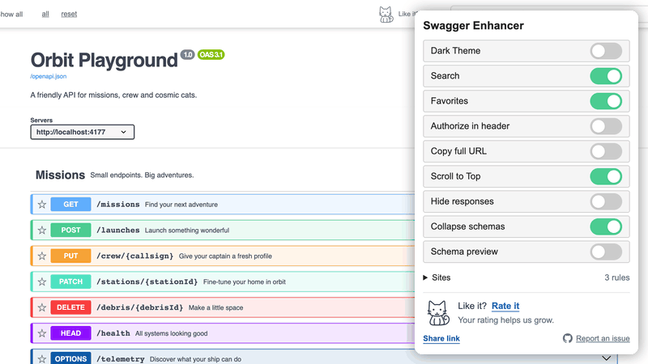
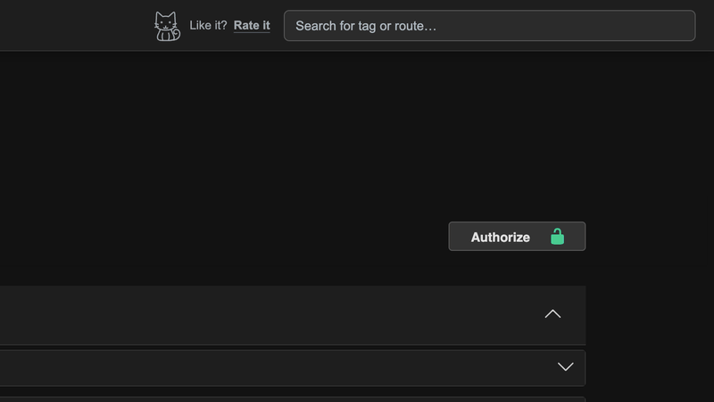
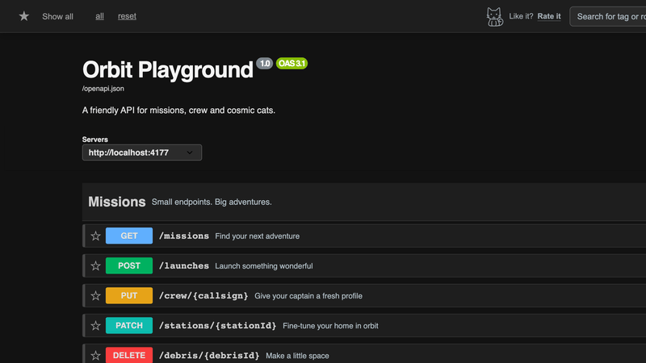
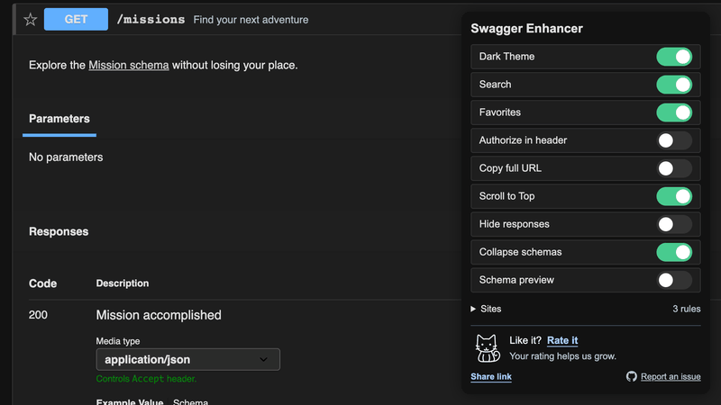
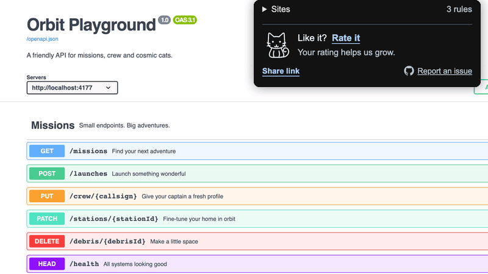

# Swagger Enhancer

[](README.md)
[](README_RU.md)
[](#development)
[](#requirements-and-privacy)
[](LICENSE)
[](#features)
[](CHANGELOG.md)

[Русский](README_RU.md) | [Releases](https://github.com/artemy-sh/swagger-enhancer/releases) | [Changelog](CHANGELOG.md) | [Chrome Web Store](https://chromewebstore.google.com/detail/swagger-enhancer/dnadagbnobcgafbdebbabcgicfkpciam)

A Chromium extension that makes Swagger UI easier to navigate. Settings sync between devices through Chrome Sync. See the changelog for release notes.

## Features

| Setting | What it does |
| --- | --- |
| Dark Theme | Switch between light and dark themes without reloading. |
| Search | Search tags, paths, methods, descriptions and operation IDs across the full specification, including offscreen operations. Respects the favorites filter. |
| Favorites | Save endpoints per specification, show or exclude favorites, select all or reset. Updates across tabs for the same specification. |
| Authorize in header | Open Swagger's authorization dialog from the fixed header. Buttons and route locks reflect authorization state. |
| Copy full URL | Copy an operation's documentation link, page origin + route path, or path alone, with confirmation. |
| Scroll to Top | Return to the top, including long virtualized lists. |
| Hide responses | Hide documented response tables while keeping executed requests and their live responses visible. |
| Collapse schemas | Collapse Schemas by default. Explicit links reveal and expand the requested model, including models outside the viewport. |
| Schema preview | Inspect fields, types, required properties, descriptions and references in a card next to a schema link. Includes Back and Open in Schemas. |

The header and popup also offer rating, sharing and GitHub issue links. The outline cat follows the pointer subtly and hops on hover. Animations respect reduced motion. Keyboard focus stays on individual controls.

**Light and dark themes**



**Search across the full specification**



**Favorites**



**Schema preview**



**Custom sites**



## Installation and use

Install from [Chrome Web Store](https://chromewebstore.google.com/detail/swagger-enhancer/dnadagbnobcgafbdebbabcgicfkpciam). For manual installation, extract the ZIP from [GitHub Releases](https://github.com/artemy-sh/swagger-enhancer/releases), open `chrome://extensions`, enable Developer Mode and choose **Load unpacked** with the extracted folder. Store updates become available after review.

1. Open a Swagger UI page and click the extension icon.
2. Enable the features you need. Search, Favorites and Scroll to Top are enabled on a fresh installation. Other switches are off by default.
3. Feature changes save automatically and apply to enabled Swagger tabs. After updating the extension itself, reload the documentation page.

Search supports Up/Down, Enter and Escape. Schema cards close with Escape or a click outside. Ctrl/Meta-click keeps normal schema-link behavior.

### Sites

Open **Sites** to edit where the panel appears. Standard `/docs`, `/swagger` and `/openapi` rules are prefilled as removable tags. Add domains, URL prefixes or wildcard patterns, separated by commas:

```text
api.example.com, *.internal.example.com, http://localhost:8080/reference
```

Choose **Save sites**, then reload the documentation. An empty list disables the panel everywhere. **Restore defaults** resets the draft, which must also be saved. Swagger UI must still be present, ordinary pages remain unchanged.

## Requirements and privacy

- Chromium 111+ (Chrome, Edge, Yandex Browser and compatible browsers). Required by [MAIN-world manifest content scripts](https://developer.mozilla.org/en-US/docs/Mozilla/Add-ons/WebExtensions/manifest.json/content_scripts#browser_compatibility).
- Tested with Swagger UI 4.19.1 and 5.33.0, OpenAPI 3.0/3.1, both themes and narrow screens. Full-spec filtering, copy controls and schema previews use the standard `SwaggerUIBundle` adapter. Custom builds retain a DOM fallback with search limited to mounted operations.
- `storage` saves preferences, `scripting` registers scripts for custom sites using the existing host access. The extension does not collect analytics or send API data to developer servers. Favorites stay in the site's localStorage, schema previews use already loaded data. See the [privacy policy](privacy.md).

## Development

Run `npm run demo` for the local [Orbit Playground and film sources](demo/README.md) at http://localhost:4177/docs.

Node.js 20.19+ and npm:

```bash
npm ci
npx playwright install chromium
npm test
npm run test:browser
```

Node tests cover feature behavior, failure recovery and real Swagger selectors. Browser tests load the actual extension in temporary Chromium profiles and check both themes, popup sizing, mouse/keyboard focus, cross-tab settings, copy controls, authorization, schemas, site rules and large virtualized specifications. Only local fixtures and a test GET are used. Set `SWAGGER_TEST_CHROMIUM` to use another compatible Chromium executable.

Run `npm run package` to build the versioned ZIP and SHA-256 checksum in `dist/`. The package includes the runtime, license and privacy policy, excluding tests, dependencies, demos and development scripts. Versions and runtime file references are checked before packaging. See [release materials](docs/RELEASE.md) for store descriptions and submission details.

## Feedback

[Report a bug or suggest a feature](https://github.com/artemy-sh/swagger-enhancer/issues) | [Rate the extension](https://chromewebstore.google.com/detail/swagger-enhancer/dnadagbnobcgafbdebbabcgicfkpciam/reviews)

Author: [Artemy Shalygin](mailto:artemy.sh@gmail.com). [MIT License](LICENSE).
