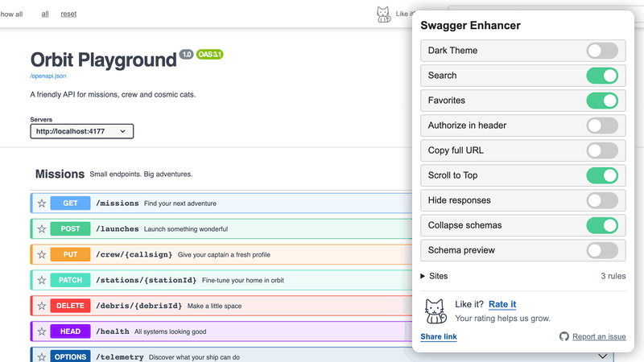
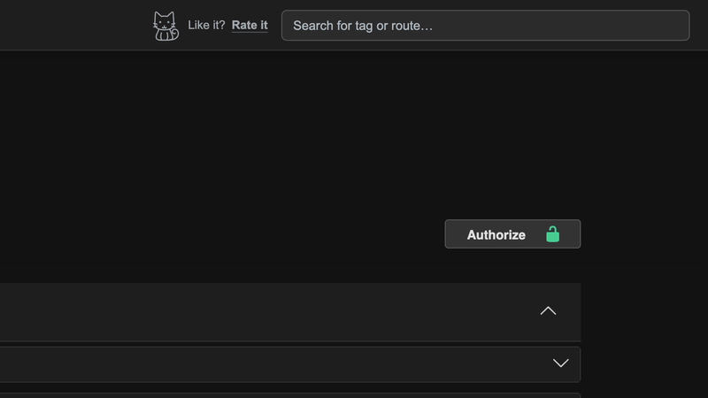
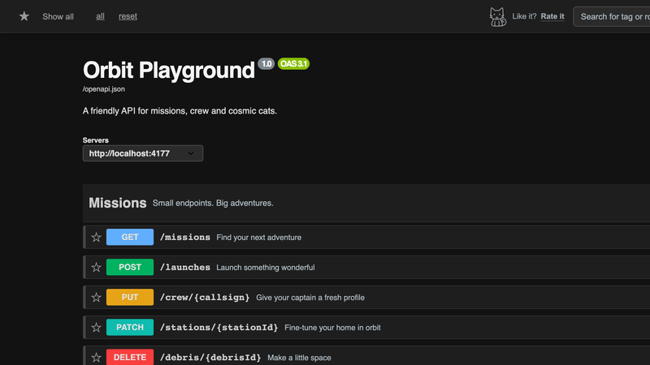
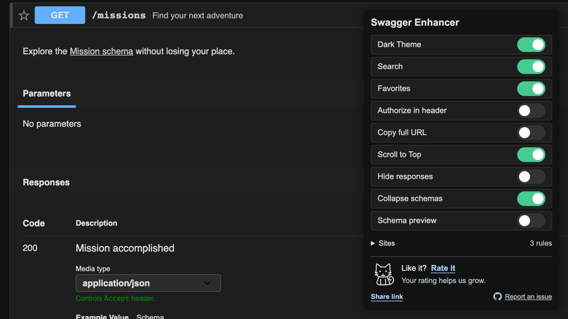
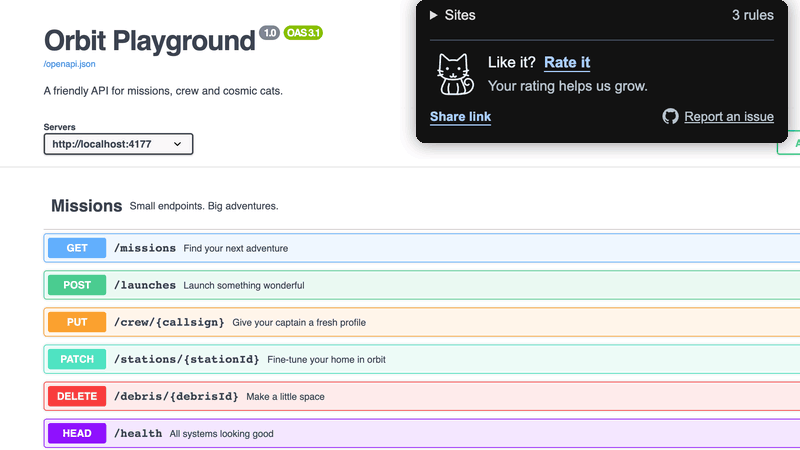

# Swagger Enhancer

[English](README.md) | [Релизы](https://github.com/artemy-sh/swagger-enhancer/releases) | [История изменений](CHANGELOG.md) | [Chrome Web Store](https://chromewebstore.google.com/detail/swagger-enhancer/dnadagbnobcgafbdebbabcgicfkpciam)

Расширение для Chromium, которое упрощает работу со Swagger UI. Настройки синхронизируются через Chrome Sync. Изменения версий перечислены в changelog.

## Возможности

| Настройка | Что делает |
| --- | --- |
| Dark Theme | Переключает светлую и тёмную тему без перезагрузки. |
| Search | Ищет теги, пути, HTTP-методы, описания и operation ID по всей спецификации, включая методы вне экрана. Учитывает фильтр избранного. |
| Favorites | Сохраняет избранное отдельно для каждой спецификации, позволяет показать или исключить избранное, выбрать всё и сбросить выбор. Обновляется между вкладками одной спецификации. |
| Authorize in header | Открывает окно авторизации Swagger из закреплённой шапки. Кнопки и замки методов показывают состояние авторизации. |
| Copy full URL | Копирует ссылку на документацию метода, полный URL роута на текущем хосте либо только путь. Показывает подтверждение. |
| Scroll to Top | Возвращает наверх, в том числе в длинных виртуальных списках. |
| Hide responses | Скрывает таблицы описанных ответов, сохраняя выполненные запросы и их результаты. |
| Collapse schemas | Сворачивает Schemas по умолчанию. Прямая ссылка показывает и раскрывает нужную модель, в том числе за пределами экрана. |
| Schema preview | Показывает поля, типы, обязательность, описания и связанные схемы в карточке рядом со ссылкой. Есть Back и переход Open in Schemas. |

В шапке и настройках доступны оценка расширения, ссылка для коллег и обращение в GitHub. Контурный кот слегка следит за мышью и подпрыгивает при наведении. Учитывается уменьшение движения в системе. Клавиатурный фокус остаётся на отдельных элементах.

<details>
<summary>Короткие демонстрации возможностей</summary>

**Светлая и тёмная темы**



**Поиск по всей спецификации**



**Избранное**



**Карточки схем**



**Свои адреса документации**



</details>

## Установка и использование

Установите расширение из [Chrome Web Store](https://chromewebstore.google.com/detail/swagger-enhancer/dnadagbnobcgafbdebbabcgicfkpciam). Для ручной установки распакуйте ZIP из [GitHub Releases](https://github.com/artemy-sh/swagger-enhancer/releases), откройте `chrome://extensions`, включите режим разработчика и выберите распакованную папку через **Загрузить распакованное расширение**. Обновления в сторе становятся доступны после проверки.

1. Откройте Swagger UI и нажмите иконку расширения.
2. Включите нужные функции. После новой установки включены Search, Favorites и Scroll to Top, остальные переключатели выключены.
3. Изменения сохраняются автоматически и применяются на разрешённых вкладках Swagger. После обновления самого расширения перезагрузите страницу документации.

В поиске работают стрелки вверх/вниз, Enter и Escape. Карточка схемы закрывается по Escape или клику снаружи. Ctrl/Meta-клик сохраняет обычное поведение ссылки на схему.

### Адреса

В разделе **Sites** задаются адреса, на которых появляется панель. Стандартные правила `/docs`, `/swagger` и `/openapi` уже добавлены тегами, любой из них можно удалить. Домены, URL и шаблоны можно вводить через запятую:

```text
api.example.com, *.internal.example.com, http://localhost:8080/reference
```

Нажмите **Save sites**, затем обновите документацию. Пустой список отключает панель везде. **Restore defaults** возвращает стандартные правила в редактор, результат также нужно сохранить. Дополнительно проверяется наличие Swagger UI, обычные страницы не меняются.

## Требования и данные

- Chromium 111+ (Chrome, Edge, Яндекс.Браузер и совместимые браузеры). Требуется для [скриптов MAIN в манифесте](https://developer.mozilla.org/en-US/docs/Mozilla/Add-ons/WebExtensions/manifest.json/content_scripts#browser_compatibility).
- Проверено на Swagger UI 4.19.1 и 5.33.0, OpenAPI 3.0/3.1, в обеих темах и на узком экране. Фильтрация всей спецификации, кнопки копирования и карточки схем используют адаптер стандартного `SwaggerUIBundle`. В нестандартных сборках остаётся DOM-режим с поиском только по смонтированным методам.
- `storage` сохраняет настройки, `scripting` регистрирует скрипты для пользовательских адресов в пределах существующего доступа к сайтам. Аналитики и передачи данных API на серверы разработчика нет. Избранное хранится в localStorage сайта, карточки используют уже загруженные схемы. Подробнее в [политике конфиденциальности](privacy.md).

## Разработка

Команда `npm run demo` запускает локальный [Orbit Playground с исходниками ролика](demo/README.md) на http://localhost:4177/docs.

Node.js 20.19+ и npm:

```bash
npm ci
npx playwright install chromium
npm test
npm run test:browser
```

Node-тесты проверяют поведение функций, восстановление после ошибок и настоящие селекторы Swagger. Браузерные тесты загружают расширение во временные профили Chromium: обе темы, размеры popup, мышь и клавиатура, синхронизация вкладок, копирование, авторизация, схемы, адреса и большие виртуальные списки. Используются только локальные страницы и тестовый GET. Переменная `SWAGGER_TEST_CHROMIUM` позволяет выбрать другой совместимый Chromium.

Команда `npm run package` создаёт ZIP с номером версии и SHA-256 в `dist/`. В архив попадают рабочие файлы, лицензия и политика конфиденциальности, без тестов, зависимостей, демо и служебных скриптов. Перед сборкой проверяются версии и ссылки на файлы расширения. Описания для стора и порядок публикации находятся в [материалах релиза](docs/RELEASE.md).

## Обратная связь

[Сообщить об ошибке или предложить фичу](https://github.com/artemy-sh/swagger-enhancer/issues) | [Оценить расширение](https://chromewebstore.google.com/detail/swagger-enhancer/dnadagbnobcgafbdebbabcgicfkpciam/reviews)

Автор: [Артемий Шалыгин](mailto:artemy.sh@gmail.com). [Лицензия MIT](LICENSE).
